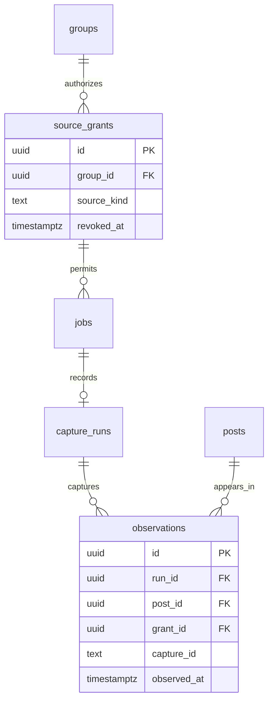
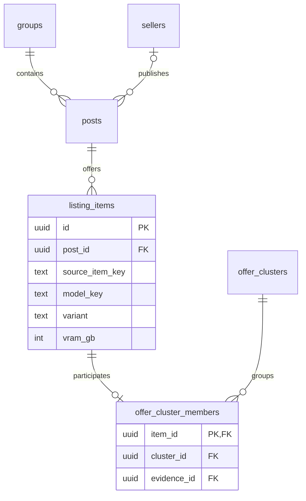
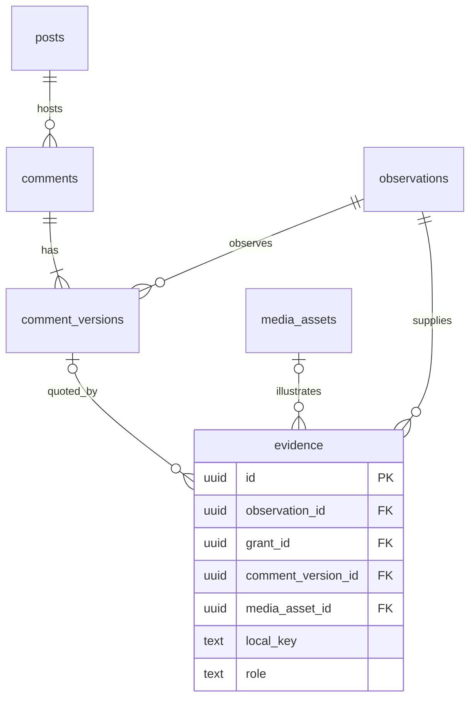
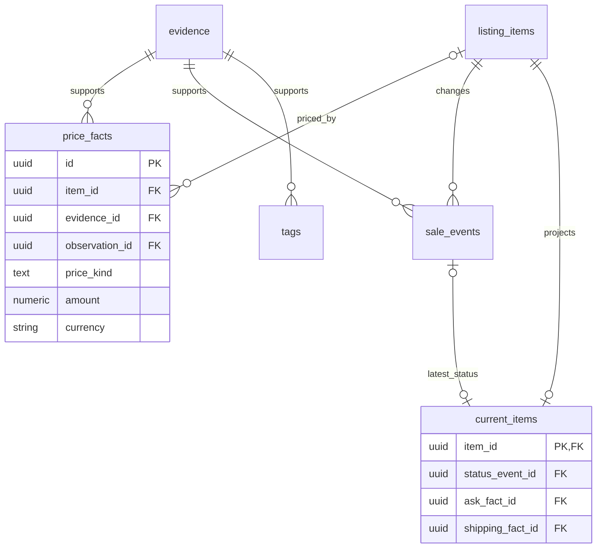
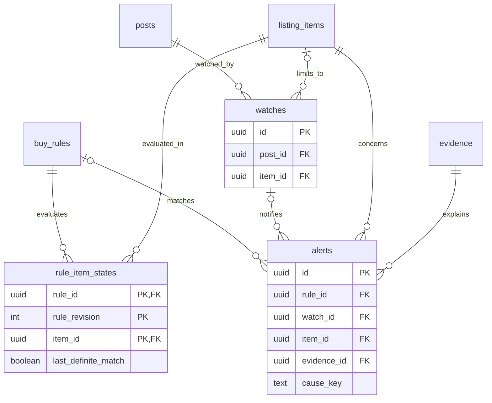

# ERD ฐานข้อมูลป้ายยา

**สถานะ** แบบจำลองเชิงตรรกะสำหรับ PostgreSQL 17 · 7 พฤศจิกายน 2026

อ่านรูปจากคีย์ด้านพ่อไปหาคีย์ด้านลูก `||` หมายถึงหนึ่งพอดี `o|` หรือ `|o` หมายถึงศูนย์หรือหนึ่ง และ `o{` หมายถึงศูนย์ถึงหลายแถว ตารางที่ปรากฏซ้ำเป็นตารางเดียวกัน ภาพแสดงความสัมพันธ์หลัก ส่วน composite FK ที่ป้องกันข้อมูลข้ามโพสต์และข้ามสิทธิ์ระบุในพจนานุกรม [แบบจำลองข้อมูลและกฎตรวจ](../data-model.md)

## 1. ใครให้สิทธิ์ และได้ข้อมูลมาจากรอบใด

งาน discovery หนึ่งรอบอาจเห็นหลายโพสต์ ส่วนการส่ง P1 ด้วยมือสร้างรอบที่ระบุวิธีนำเข้าและสิทธิ์ของผู้ส่ง การ retry รอบเดิมอ้าง run และ capture เดิม หนึ่งโพสต์จึงมีประวัติได้หลายรอบภายใต้สิทธิ์ต่างกัน งานคิวที่ใช้ตีความข้อมูลมี job โดยไม่มี capture_run

## 2. ชิ้นสินค้า ผู้ขาย และข้อเสนอข้ามกลุ่ม

ชื่อผู้ขายที่ยังยืนยันไม่ได้อนุญาตให้โพสต์ไม่มี seller_id หากมีหลักฐานว่าชิ้นเดียวกันถูกนำไปลงสองกลุ่ม ให้คงโพสต์และชิ้นของแต่ละกลุ่มไว้ สมาชิก cluster ช่วยตัดการนับข้อเสนอซ้ำเมื่อคำนวณราคากลาง

## 3. ตรวจว่าใครพูด และหลักฐานมาจากไหน

หนึ่งหลักฐานอาจเป็นข้อความอย่างเดียว ข้อความจากคอมเมนต์ต้องชี้รุ่นข้อความที่พบในรอบนั้นและตรวจผู้เขียนก่อนตั้งสถานะ ภาพเดียวใช้กับหลายหลักฐานได้โดยแต่ละหลักฐานมีสิทธิ์ของตน เรียกดูผ่าน evidence ID

## 4. ข้อเท็จจริงที่ผู้ซื้อเห็น

ข้อความเดียวรองรับหลายข้อเท็จจริงได้ เช่น ราคาขายกับค่าส่งต่อชิ้น เส้นไป price_facts ยอมให้ item_id ว่างสำหรับจำนวนเงินระดับโพสต์ที่ยังจัดสรรไม่ได้ ค่า current_items เป็นผลปัจจุบันของชิ้นนั้น ส่วนประวัติยังดูได้จาก sale_events และ observations

## 5. ตั้งรับ ติดตาม และอ่านการแจ้งเตือน

แต่ละ alert เลือกต้นเหตุจาก buy_rules หรือ watches เพียงทางเดียว ทุกแถวระบุชิ้นที่ได้รับผล Watch ระดับโพสต์มี item_id เป็น NULL หากติดตามเฉพาะ 3060 ให้ชี้ไปที่ชิ้น 3060 โดยยังเปิด permalink เดียวกับ 3070 ได้ คีย์ผสมป้องกันการแจ้งเหตุเดิมซ้ำ และหน้าเทียบดีลดึงข้อมูลจากหลายชิ้นเป็นรายคำขอ

เมื่อเพิกถอนสิทธิ์ให้ปิดการอ่านตั้งแต่ต้นทางไปจนถึงกล่องแจ้งเตือน งานลบทำผ่าน purge_jobs ตามขอบเขตคำขอ ซึ่งอาจครอบคลุมหลายตาราง วิธีเก็บบันทึกลบ แยก reference รูป และทดสอบหลัง restore อยู่ใน [วงจรข้อมูลและดัชนี](../data-model.md) · [เส้นทางการเก็บและการอ่าน](observation-flow.md)
