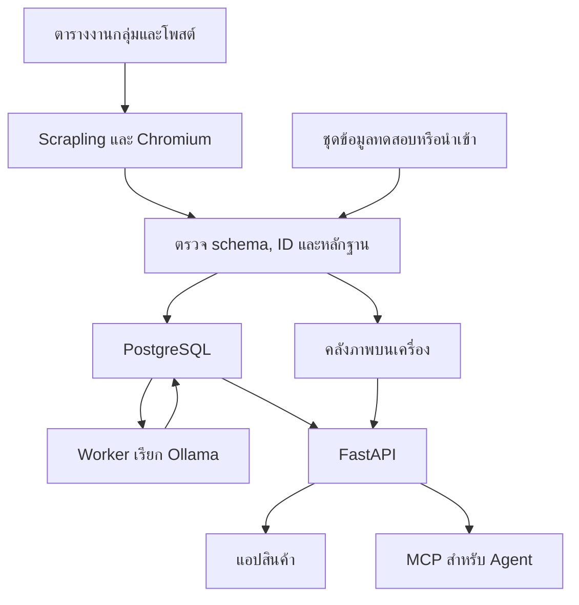

# เส้นทางข้อมูลจากรอบตรวจถึงผู้ซื้อ

**สถานะ** แบบที่ใช้อ้างอิงสำหรับ MVP · รอยืนยันด้วย fixture

**ผู้ดูแล** Tech lead ร่วมกับผู้รับผิดชอบ Collector และ API

แต่ละรอบสร้าง observation หรือบันทึกสิ่งที่เห็น ณ เวลาตรวจ แอปกับ Agent ใช้บันทึกนี้เพื่อตอบว่าผู้ขายแจ้งอะไร เมื่อไหร่ และเปิดหลักฐานชิ้นไหนได้ เส้นทางจากชุดทดสอบและจากกลุ่มที่มีสิทธิ์มาบรรจบกันที่ขั้นตรวจข้อมูลนำเข้า

## เงื่อนไขที่ต้องรักษาตลอดเส้นทาง

1. ตรวจสิทธิ์ก่อนเก็บและก่อนบันทึกผล เมื่อเก็บภาพได้ ให้เขียนไฟล์ให้เสร็จก่อน commit ข้อมูลกำกับภาพกับ observation ใน SQL เมื่อภาพขาด ให้บันทึกเหตุผลพร้อมข้อความที่อ่านได้
2. Worker ส่งงานตีความให้ Ollama หลัง commit ผู้ใช้ยังค้นและเปิดหลักฐานเดิมได้ระหว่างรอผลหรือเมื่อโมเดลหยุดทำงาน
3. เมื่อ UI หรือ MCP ขอเปิดภาพ ให้ API ตรวจสิทธิ์ของ evidence ID นั้นอีกครั้ง โดยอ้างโพสต์และรอบตรวจเดียวกับที่ระบุในผลค้น

## ตัวอย่างสำหรับทดสอบ

ใช้ประกาศจำลองชิ้นเดียวกันสามรอบ ผู้ขายแจ้ง “ยังขายอยู่” จากนั้น “ติดจอง” และ “หลุดจอง ขายต่อ” ผลที่คาดคือมีประวัติสามสถานะตามลำดับ แต่ละสถานะชี้ถึงคำยืนยันของรอบนั้น เมื่อนำรอบที่สองมา replay หลังรอบที่สาม สถานะล่าสุดยังเป็นเปิดขายและไม่มีเหตุการณ์ติดจองเพิ่ม ผู้ทดสอบต้องเปิดหลักฐานของรอบที่สองจากทั้ง UI และ MCP แล้วได้ observation เดียวกัน

ใช้ FR-05, FR-07, FR-10, FR-11 และ FR-13 ตรวจขอบเขตการบันทึกและการเข้าถึง ใช้ AT-03, AT-05, AT-08 และ AT-09 ทวนผลก่อนบันทึกหลักฐานในตารางติดตาม [ข้อกำหนดระบบ](../../requirements/SRS.md) · [ตารางตรวจรับ](../../quality/TRACEABILITY.md)

## เมื่อใดต้องแก้ภาพนี้

แก้ใน PR เดียวกับการเปลี่ยนเส้นทางของข้อมูล เช่น ย้ายจุดเขียนภาพ เรียก AI ก่อนบันทึกรอบตรวจ หรือให้บริการใหม่อ่านหลักฐาน หากเปลี่ยนรูปแบบข้อมูลที่ส่งข้ามส่วน ให้ตรวจสัญญาที่ใช้ด้วย [สเปกสถาปัตยกรรม](../SPEC.md) · [สัญญาข้อมูลนำเข้าและการค้น](../contracts/collector-and-query.md)
